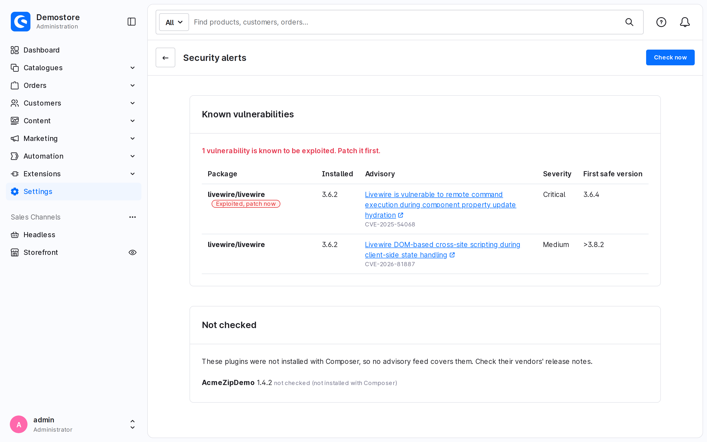

<p align="center">
  <a href="https://github.com/Ruvelo/shopware-security-alerts/actions/workflows/tests.yml"></a>
  
  
  
  <a href="LICENSE"></a>
</p>

# Ruvelo Security Alerts for Shopware 6

**Know before they do.** This plugin tells you, in the Shopware administration and by email, when the exact version of `shopware/core`, or a plugin or app you installed with Composer, has a known vulnerability. When the flaw is **exploited in the wild** it says so first: "Exploited, patch now".

It is the Shopware adapter on [`ruvelo/security-advisories`](https://github.com/Ruvelo/security-advisories), the framework-agnostic core behind Ruvelo's security alerts. It is free, MIT licensed, and needs no account and no API key.

```
composer require ruvelo/shopware-security-alerts
bin/console plugin:refresh
bin/console plugin:install --activate RuveloSecurityAlerts
bin/build-administration.sh
```

> **Not published yet.** The plugin and its core are not on Packagist, so `composer require` will not find them until they are. Until then, add both repositories as VCS repositories in your shop's `composer.json`.

## A quick tour



> **This is a real screenshot** from the CI job that installs the plugin in a fresh Shopware 6.7 (`.github/workflows/tests.yml`, artifact `admin-security-alerts.png`). The demo shop is empty, so the test adds one old `livewire/livewire` to its `composer.lock`, which is a real advisory that CISA lists as exploited, and unpacks a made-up plugin, `AcmeZipDemo`, into `custom/plugins` the way a zip install would.

**One page, exploited first.** Settings, System, Security alerts lists every finding: the package, the installed version, the advisory (a link, with the CVE), the severity, an "Exploited, patch now" label, and the first version that is not affected. "Check now" runs the check straight away.

**An honest "not checked" list.** Plugins unpacked from a zip into `custom/plugins` are not in `composer.lock`, so no advisory feed covers them. They are listed with their name and version, marked "not checked (not installed with Composer)", in the page, the CLI and the JSON.

## Features

- **Core and Composer extensions.** The exact versions come from `composer.lock`: `shopware/core`, the storefront and administration packages, and every plugin and app installed with Composer.
- **Exploited in the wild, first.** Findings whose CVE is on the [CISA Known Exploited Vulnerabilities](https://www.cisa.gov/known-exploited-vulnerabilities-catalog) list are labelled, sorted first and always emailed.
- **Only what is new.** Findings are stored, so you get an email for a new finding, or for one that has *become* exploited, and not the same list every morning.
- **A fix version.** For each finding, the first version that is not affected, matched locally with `composer/semver`.
- **Everywhere you need it.** A daily scheduled task, a page in the administration, an email, a console command for CI, and an event for your own tooling.
- **Free sources, no keys.** Packagist's security advisories and the CISA catalogue, both public.
- **Cheap.** A handful of HTTPS requests a day.

Watching many shops? [Valtry](https://valtry.co.uk/?utm_source=ruvelo&utm_medium=github&utm_campaign=shopware-security-alerts) checks every site from the outside, daily.

## What it sends

Only **package names** leave your server, to `packagist.org`, and a plain download of the whole catalogue from `cisa.gov`. Versions are matched on your server, so nobody learns which version you run. No shop URL, no customer or order data, no account, no keys. The requests use Guzzle (already part of Shopware), which honours `HTTP_PROXY` and `HTTPS_PROXY`.

## What it does not cover

- **Plugins that are not installed with Composer** (zips under `custom/plugins`, including Store downloads that are not managed by Composer). They are listed as not checked. Watch their vendors' release notes.
- **Shopware apps** installed from a manifest, and **cloud apps**. They are not Composer packages and are not listed.
- **Flaws nobody has published.** It knows what Packagist's advisory database (built on GitHub's and FriendsOfPHP's) lists, and which of those CVEs CISA says are exploited. It is an early warning, not a scanner: it does not read your files, themes or admin users.
- **Backported fixes.** The free [Shopware Security Plugin](https://developer.shopware.com/docs/guides/hosting/installation-updates/security-plugin.html) backports core fixes without changing the version number, so a finding for `shopware/core` can describe a flaw that plugin already fixes. This plugin cannot see that. Use both: that one patches, this one tells you what is open.
- **Isolated patches** applied by hand do not change `composer.lock`, so the finding stays.

## Requirements

Shopware 6.6 or 6.7, PHP 8.2 to 8.4, and a `composer.lock` in the project root (the standard `shopware/production` layout). Both versions are installed for real in CI.

## Install

```bash
composer require ruvelo/shopware-security-alerts
bin/console plugin:refresh
bin/console plugin:install --activate RuveloSecurityAlerts
bin/build-administration.sh     # builds the administration; part of every Shopware deploy
```

The administration source is in `src/Resources/app/administration/src`, and Shopware builds it with the rest of the administration. This is how store plugins ship, but this repository does not commit built files. If you install from a git checkout or a zip without running `bin/build-administration.sh`, the page will not appear, while the command, the scheduled task and the emails still work.

### Shopware Store notes

- The plugin technical name is `RuveloSecurityAlerts`. `composer.json` carries the English and German labels and descriptions that Shopware reads.
- `CHANGELOG.md` and `CHANGELOG_en-GB.md` are both present, as the Store asks for.
- A Store upload should be built with the compiled administration assets in `src/Resources/public/administration` (for example with `shopware-cli extension build`). That step is not part of this repository and has not been done here.
- The plugin has not been submitted to the Store.

## Configuration

Settings, System, Plugins, then Ruvelo Security Alerts (or Extensions, My extensions).

| Setting | Default | What it does |
|---|---|---|
| Send email alerts | on | Emails are sent only when this is on **and** there are recipients. The check runs daily either way. |
| Send alerts to | empty | Comma-separated addresses. Empty means no email. |
| Minimum severity | medium | Findings below it are not emailed. Exploited findings always are. |
| Also check development packages | off | Include `packages-dev` from `composer.lock`. |

The email goes through Shopware's mail service, so your mail settings (and `MAILER_DSN`) apply. The sender is the shop's own address (`core.basicInformation.email`), or the first recipient when the shop has none. It lists exploited findings first and contains nothing but the findings.

The scheduled task is `ruvelo.security_alerts.check`, daily. It needs the usual Shopware scheduler and message worker (`scheduled-task:run` and `messenger:consume`).

**Permissions.** The page needs the privilege *Security alerts: viewer* (Settings, Permissions), and "Check now" needs *editor*. Admins have both.

## Command line

```
bin/console ruvelo:security-alerts:check [--json] [--fail-on=exploited|critical|high|medium|any] [--dry-run] [--fresh]
```

| Option | What it does |
|---|---|
| *(none)* | Check, store what changed, email what is new, and print the findings |
| `--json` | Print the report as JSON |
| `--fail-on=…` | Exit with `1` when a finding is at least that bad (`exploited` is only the exploited ones) |
| `--dry-run` | Only report: nothing stored, no email, no event |
| `--fresh` | Ignore cached advisories |

Exit codes: `0` fine, `1` a finding matched `--fail-on`, `2` the check was incomplete (Packagist or CISA unreachable, or `composer.lock` unreadable) or an option is wrong. "No findings" is not "clean" when the exit code is 2.

```bash
bin/console ruvelo:security-alerts:check --dry-run --json --fail-on=exploited > alerts.json
```

The JSON is the core's report (`checked_at`, `clean`, `complete`, `packages`, `counts`, `problems`, `findings`) plus `not_checked`:

```json
{
  "clean": false,
  "complete": true,
  "packages": { "composer": 312 },
  "findings": [
    { "package": "livewire/livewire", "installed": "3.6.2", "severity": "critical", "cve": "CVE-2025-54068", "exploited": true, "fixed_in": "3.6.4" }
  ],
  "not_checked": [
    { "name": "AcmeZipDemo", "version": "1.4.2", "reason": "not checked (not installed with Composer)" }
  ]
}
```

(Shortened; each finding has more fields: `key`, `advisory_id`, `title`, `link`, `kev`, `affected_versions` and so on.)

## Administration API

Both routes use the administration API scope and ACL.

| Route | Privilege | Does |
|---|---|---|
| `GET /api/_action/ruvelo-security-alerts/findings` | `ruvelo_security_alerts:read` | Stored findings (exploited first), the not-checked plugins and the last check |
| `POST /api/_action/ruvelo-security-alerts/check` | `ruvelo_security_alerts:check` | Runs a fresh check, as "Check now" does |

## Events

`Ruvelo\SecurityAlerts\Event\SecurityFindingsFoundEvent` (`ruvelo.security_alerts.found`) is dispatched after every recorded check that has at least one finding. It carries the core `Report` and `Changes` (`new`, `exploited`, `resolved`), so a listener can tell what is news. It is not dispatched for `--dry-run`.

## FAQ

**Does it patch anything?** No. It tells you what to update.

**Why is a finding still there after I updated?** The check runs daily. Press "Check now", or run the command. A finding disappears only after a complete check that no longer matches.

**Does it slow the shop down?** Nothing runs on a storefront request. The daily task makes a handful of HTTP requests.

**Is the list complete?** No. See [What it does not cover](#what-it-does-not-cover).

## Development

```bash
composer install
composer check      # Pint, PHPStan level 8 and the unit tests, as CI runs them
```

Until `ruvelo/security-advisories` is on Packagist, CI adds it as a VCS repository, and so must you: `composer config repositories.ruvelo-core vcs https://github.com/Ruvelo/security-advisories`. That line is never committed. See [CONTRIBUTING.md](CONTRIBUTING.md) and the [changelog](CHANGELOG.md).

CI also runs a real install on Shopware 6.6 and 6.7 with MySQL 8: plugin install and activation, the table, the scheduled task, the command against the live sources, an email caught by Mailpit, the administration API with a real token, the plugin's uninstall and, on 6.7, a build of the administration with a screenshot of the page.

## Credits

Built by [François Bultez](https://github.com/francoisbultez) at [Valtry](https://valtry.co.uk/?utm_source=ruvelo&utm_medium=github&utm_campaign=shopware-security-alerts), the website security scanner, and everyone who [contributes](https://github.com/Ruvelo/shopware-security-alerts/graphs/contributors).

Advisory data comes from the [Packagist security advisories API](https://packagist.org/apidoc#list-security-advisories) and the [GitHub Advisory Database](https://github.com/advisories). The list of exploited vulnerabilities is the [CISA KEV catalogue](https://www.cisa.gov/known-exploited-vulnerabilities-catalog).

## License

MIT. See [LICENSE](LICENSE).
